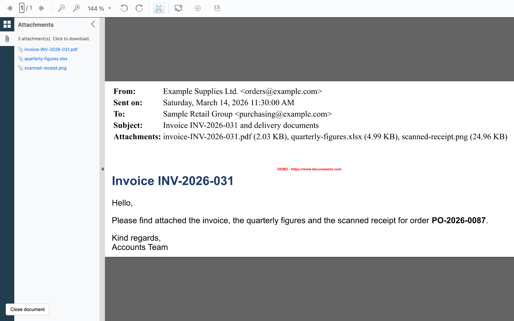
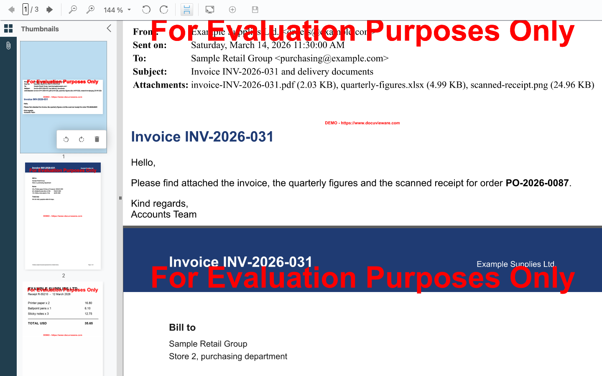

# Nutrient Email Attachments Viewer

A Nutrient.io demo that opens EML and MSG emails in DocuVieware, lists their attachments in a side panel for download, merges several files into one PDF and saves the result on the server.



*Screenshots are taken in evaluation mode, so DocuVieware and GdPicture show demo marks on the pages.*

1. **Viewer.** An ASP.NET Core app (.NET 10) hosts the DocuVieware control and serves the page `wwwroot/index.html`. The page gets the control markup from `POST /api/DocuVieware/GetDocuViewareControl`. Every page load starts a new viewer session.
2. **Load and merge.** A custom toolbar button opens a file picker. The files are sent to the server as base64 through DocuVieware custom actions. One file is opened as is. Several files, or a file added to an open document, are combined into one PDF with GdPicture `CombineToPDF`. Emails are converted to PDF first.
3. **Attachments.** When a document is loaded, a custom snap-in asks the server for its attachments. GdPicture converts the email to PDF, which keeps each attachment as an embedded file, and the server lists the embedded files. PDF files with embedded files work the same way.
4. **Download.** A click on an attachment extracts it on the server (`ExtractEmbeddedFile`) and the browser saves it.
5. **Save on server.** A second custom toolbar button writes the current document to `EmailAttachmentsDemo/SavedDocuments`. The file is then available at `/saved-documents/<name>`.
6. **Close the last page.** DocuVieware does not delete the only page of a document, so the page adds a delete entry to the thumbnail menu and a **Close document** button that close the document instead.

## Prerequisites

- .NET SDK 10
- Windows, macOS or Linux (DocuVieware.API is cross-platform)
- Internet access: the page loads jQuery from the Google CDN

## Environment variables

Both variables are optional. Start from `.env.example`. The license key is only read from the environment, never from code.

| Variable | Purpose | Default |
|---|---|---|
| `DOCUVIEWARE_LICENSE_KEY` | DocuVieware license key | empty = evaluation mode |
| `APP_URI` | Address the app listens on. DocuVieware also puts it into the control markup, so the browser must be able to reach it | `http://localhost:62500` |

In evaluation mode DocuVieware and GdPicture show demo marks on the pages, and the process stops after one hour. Start it again, or set a trial or commercial key to remove both limits.

## Build and run

```bash
cp .env.example .env
```

```bash
cd EmailAttachmentsDemo
```

```bash
set -a && source ../.env && set +a && dotnet run
```

Open <http://localhost:62500>.

## Using the app

1. Click **Load and merge documents** (the plus icon in the toolbar) and pick `samples/email-with-attachments.eml`. The email opens with its header block and HTML body.
2. Open the **Attachments** panel (paper clip on the left). It lists the invoice PDF, the spreadsheet and the receipt image of the email. Click one to download it.
3. Click **Load and merge documents** again and pick `samples/invoice-INV-2026-031.pdf` and `samples/scanned-receipt.png`. They are merged with the open email into one three-page PDF. The email attachments stay embedded in the merged PDF.

   

4. Click **Save on server** (the disk icon). A message gives the URL of the saved file.

Accepted file types in the picker: PDF, Word, Excel, PowerPoint, EML, MSG, TXT, JPEG, PNG and TIFF.

To show the TWAIN scan button, set `EnableTwainAcquisitionButton` to `true` in `wwwroot/index.html`. Scanning needs the DocuVieware TWAIN service on a Windows client.

## Sample documents

`samples/` holds six fictitious English files: two emails with attachments, a service agreement PDF with an embedded CSV, an invoice, a delivery note and a receipt image. Names and amounts are invented and email addresses use `example.com`. They are generated by `samples/generate_samples.py`:

```bash
python3 -m venv .venv-samples
```

```bash
.venv-samples/bin/pip install reportlab openpyxl pillow pypdf
```

```bash
.venv-samples/bin/python samples/generate_samples.py
```

## API

| Method and path | Description |
|---|---|
| `POST /api/DocuVieware/GetDocuViewareControl` | Body: `{ SessionId, ControlId, EnableTwainAcquisitionButton }`. Returns `{ htmlContent }`, the control markup with the two custom toolbar buttons |
| `GET /saved-documents/{name}` | A document saved with **Save on server** |
| `api/docuvieware3/*` | Internal routes of the DocuVieware control |

Custom actions, called from the page with `DocuViewareAPI.PostCustomServerAction`:

| Action | Argument | Result |
|---|---|---|
| `LoadSingleFile` | `{ fileName, fileType, fileSize, data }` (base64) | Opens the file in the viewer |
| `MergeDocuments` | Array of the same objects | Combines the open document and the files into one PDF |
| `GetAttachmentsForLoadedDocument` | none | JSON array of attachment names |
| `DownloadAttachment_<index>` | none | `{ success, fileName, base64 }` |
| `CustomSave` | `{ fileName, isMerged }` | Saves the document in `SavedDocuments/` and returns `{ fileName, url }` |

## Project layout

| Path | Content |
|---|---|
| `EmailAttachmentsDemo/Startup.cs` | License, DocuVieware setup and the custom actions |
| `EmailAttachmentsDemo/Controllers/DocuViewareController.cs` | Control markup and toolbar settings |
| `EmailAttachmentsDemo/Controllers/DocuVieware3Controller.cs` | DocuVieware control routes |
| `EmailAttachmentsDemo/wwwroot/index.html` | Page: attachments snap-in, load and merge, save, close document |
| `samples/` | Sample files and their generator |
